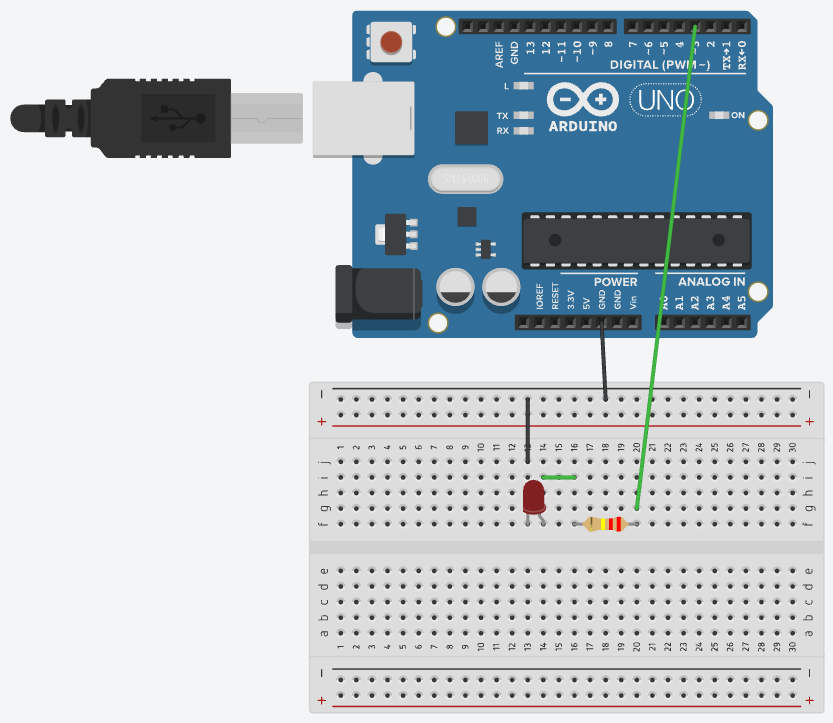
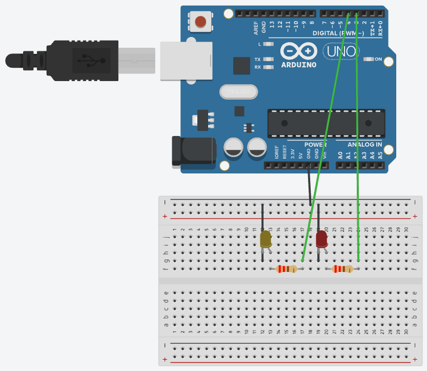
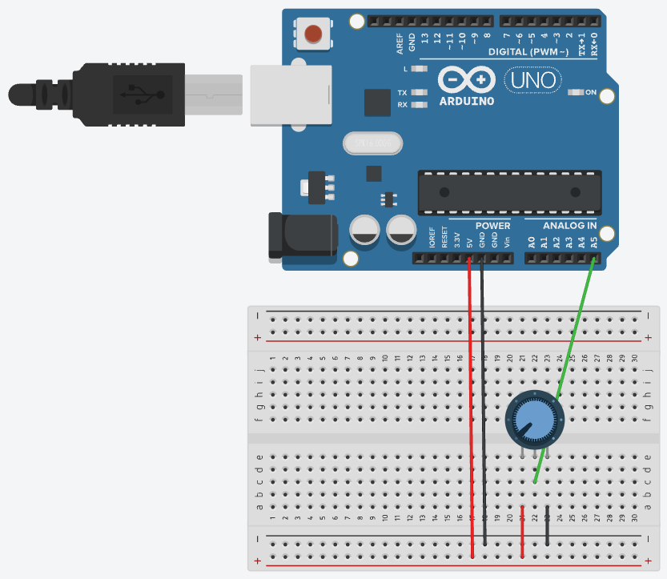
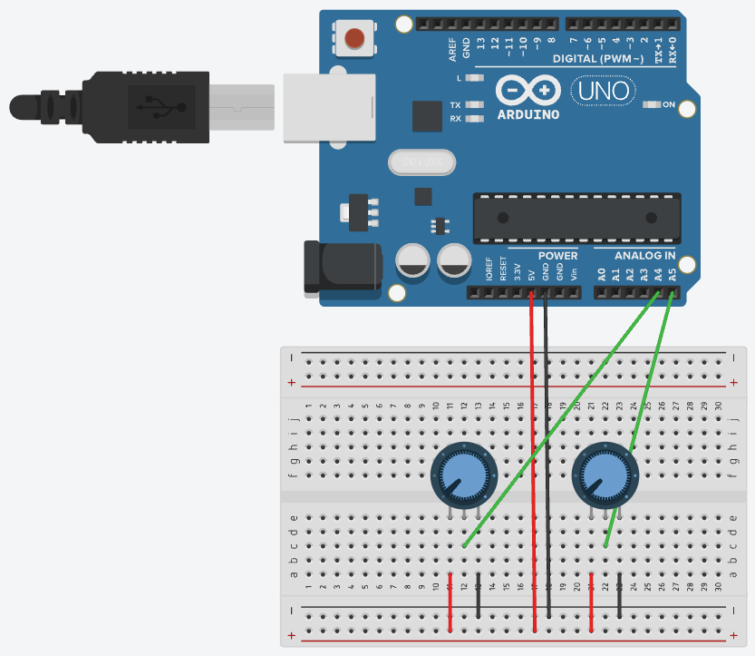
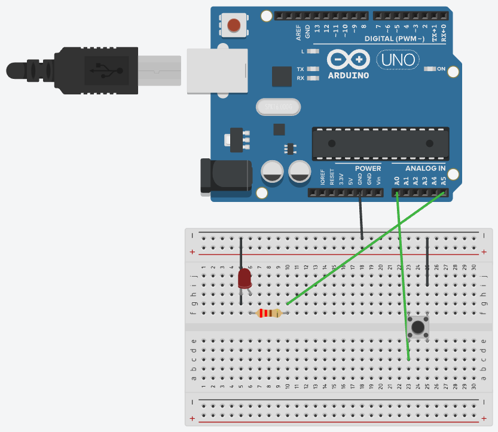
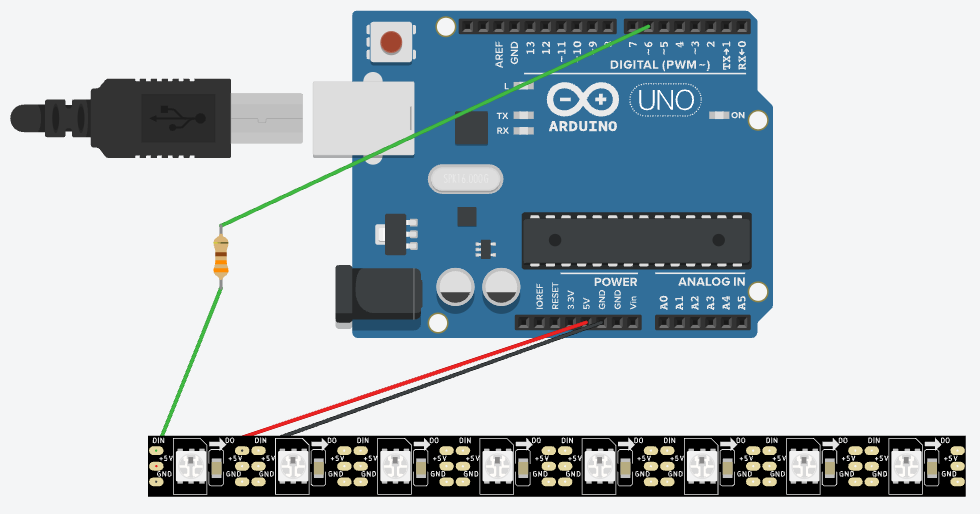

# Arduino Uno 실습 정리

Arduino Uno로 LED, 가변저항, 버튼, 인터럽트, 네오픽셀을 다뤄 본 실습 코드 모음입니다.
각 폴더가 하나의 스케치이며, Arduino IDE나 `arduino-cli`로 바로 열고 업로드할 수 있습니다.

## 목차

| 폴더 | 스케치 | 내용 |
|---|---|---|
| `01_led` | `blink` | LED 하나 깜빡이기 (D3, 0.5초) |
| | `led_pin3` | D3 핀 LED 켜고 끄기 |
| | `alternate_blink` | LED 두 개 번갈아 깜빡이기 (D3, D4) |
| | `chase` | LED 세 개 차례대로 켜기 (D3 → D4 → D5) |
| | `traffic_light` | 자동차 신호등 (초록 → 노랑 → 빨강) |
| | `blink_d8` | D8 LED 깜빡이기 (0.5초) |
| `02_analog` | `potentiometer` | 가변저항 값과 전압 읽기 (A5) |
| | `two_potentiometers` | 가변저항 두 개 읽기 (A4, A5) |
| | `pot_led_brightness` | 가변저항(A0)으로 LED(D9) 밝기 조절 (PWM) |
| | `sound_sensor_led` | 소리 크기에 따라 LED 밝기 조절 |
| | `sound_toggle` | 박수 스위치 (센서 DO로 감지) |
| | `sound_toggle_ao` | 박수 스위치 (센서 AO 진폭으로 감지, 기준 550) |
| | `sound_red_green` | 조용하면 빨강(D9), 소리 나면 초록(D10) |
| `03_button` | `button_pullup` | 외부 풀업 저항으로 버튼 읽기 |
| | `button_pulldown` | 외부 풀다운 저항으로 버튼 읽기 |
| | `button_internal_pullup` | 내부 풀업(`INPUT_PULLUP`)으로 버튼 읽기 |
| | `button_counter` | `millis()` 디바운싱 + 상태 변화 감지로 누른 횟수 세기, 5번마다 LED 토글 |
| | `button_toggle` | 누를 때마다 LED 토글 |
| | `button_gesture` | 따닥(더블 클릭) → 켜기, 길게 누르기 → 끄기, 한 번 → 무시 |
| | `button_7segment` | 버튼 누를 때마다 7세그먼트 숫자 +1, LED 반짝 |
| | `button_7segment_lab3` | 실습 3: 버튼으로 7세그먼트 숫자 +1, 0일 때 LED(D11) 켜짐 |
| | `reaction_game` | 반응속도 게임: 신호등 카운트다운, 초록일 때 누르면 +1 / 아니면 −1, 9점이면 깜빡이고 초기화 |
| `04_interrupt` | `button_interrupt` | 인터럽트로 버튼 감지, 누를 때마다 LED 토글 |
| `05_neopixel` | `neopixel_basic` | 네오픽셀 색 채우기 + 무지개 효과 |

---

## 회로 그림 (Tinkercad)

선 색: **빨강 = 5V**, **검정 = GND**, **초록 = 신호선**. LED 저항은 220Ω, 풀업/풀다운 저항은 10kΩ, 네오픽셀 저항은 330Ω입니다.

### LED

| `blink`, `led_pin3` — D3 LED 1개 | `alternate_blink` — D3, D4 LED 2개 |
|---|---|
|  |  |

| `chase`, `traffic_light` — D3(빨강), D4(노랑), D5(초록) |
|---|
|  |

### 가변저항

| `potentiometer` — A5 | `two_potentiometers` — A4, A5 |
|---|---|
|  |  |

### 버튼

| `button_pullup` — 외부 풀업 (D2 ─ 10kΩ ─ 5V, 버튼 ↔ GND) | `button_pulldown` — 외부 풀다운 (D2 ─ 10kΩ ─ GND, 버튼 ↔ 5V) |
|---|---|
|  |  |

| `button_internal_pullup` — A0 버튼 (내부 풀업) | `button_counter`, `button_gesture` — A0 버튼 + A5 LED |
|---|---|
|  |  |

| `button_toggle`, `button_interrupt` — D2 버튼(내부 풀업) + D3 LED |
|---|
|  |

### 네오픽셀

| `neopixel_basic` — D6 ─ 330Ω ─ DIN, 5V, GND |
|---|
|  |

> Tinkercad는 네오픽셀 스트립의 5V·GND 선 끝을 첫 번째 픽셀 옆에 그려 줍니다. 실제로는 스트립 왼쪽 끝의 `+5V`, `GND` 패드에 연결된 것입니다 (구조도 화면에서 확인).

---

## 실습 영상

실제 보드로 동작시킨 영상입니다. 링크를 누르면 GitHub에서 재생됩니다.

| 영상 | 스케치 | 내용 |
|---|---|---|
| [blink_d8.mp4](docs/videos/blink_d8.mp4) | `blink_d8` | D8 LED 깜빡이기 |
| [pot_led.mp4](docs/videos/pot_led.mp4) | `pot_led_brightness` | 가변저항을 돌리면 LED 밝기가 바뀜 |
| [sound_toggle.mp4](docs/videos/sound_toggle.mp4) | `sound_toggle_ao` | 박수 칠 때마다 LED 켜짐/꺼짐 |
| [sound_red_green.mp4](docs/videos/sound_red_green.mp4) | `sound_red_green` | 조용하면 빨강, 소리 나면 초록 |
| [7segment.mp4](docs/videos/7segment.mp4) | `button_7segment_lab3` | 버튼 누를 때마다 숫자 +1 |
| [reaction_game1.mp4](docs/videos/reaction_game1.mp4) | `reaction_game` | 초록일 때 누르면 +1, 빨강·주황일 때 누르면 −1 |
| [reaction_game2.mp4](docs/videos/reaction_game2.mp4) | `reaction_game` | 9점 달성 → LED 3개 깜빡임 → 초기화 |

---

## 1. 회로 결선 기본

### 브레드보드 구조
- 가운데 홈을 기준으로 **위쪽(f~j)과 아래쪽(a~e)은 서로 끊어져 있습니다.**
- 같은 **번호 줄(세로)** 5칸은 내부에서 연결되어 있습니다.
- 양쪽 끝의 **전원 레일(+, −)** 은 가로로 길게 연결되어 있습니다.
- 아두이노 **GND → 브레드보드 − 레일**을 반드시 먼저 연결해야 전류가 돌아갈 길이 생깁니다.

### LED
- **긴 다리(+, 양극)** 는 신호 핀 쪽, **짧은 다리(−, 음극)** 는 GND 쪽입니다. 거꾸로 꽂으면 켜지지 않습니다.
- LED마다 **220Ω 전류 제한 저항**을 직렬로 연결합니다.

```
디지털 핀 → 220Ω 저항 → LED 긴 다리(+)
LED 짧은 다리(−) → GND
```

### 가변저항 (포텐셔미터)
```
한쪽 끝 다리 → 5V
가운데 다리   → 아날로그 핀 (A0~A5)
다른 쪽 다리  → GND
```
- `analogRead()`는 0~5V를 **0~1023** 으로 바꿔 줍니다.
- 전압으로 바꾸려면 `value * 5.0 / 1023.0`

---

## 2. 풀업 / 풀다운 / 내부 풀업

버튼을 핀에 그냥 연결하면, 버튼을 안 눌렀을 때 핀이 어디에도 연결되지 않은 **플로팅(floating)** 상태가 되어 값이 HIGH와 LOW 사이에서 제멋대로 바뀝니다.
그래서 저항으로 기본값을 정해 줍니다.

| 방식 | 배선 | `pinMode` | 안 누름 | 누름 |
|---|---|---|---|---|
| 외부 풀업 | 핀 ─ 10kΩ ─ 5V, 버튼은 핀 ↔ GND | `INPUT` | HIGH | LOW |
| 외부 풀다운 | 핀 ─ 10kΩ ─ GND, 버튼은 핀 ↔ 5V | `INPUT` | LOW | HIGH |
| 내부 풀업 | 버튼만 핀 ↔ GND (저항 없음) | `INPUT_PULLUP` | HIGH | LOW |

- 내부 풀업은 칩 안에 있는 저항(약 20~50kΩ)을 쓰므로 **저항을 따로 달 필요가 없어** 가장 간단합니다.
- 풀업 방식은 **누르면 LOW** 이므로 코드에서 반대로 생각해야 합니다.
- 우노에는 내부 풀다운이 없습니다.

### 버튼 다리
- 4다리 택트 스위치는 **브레드보드 가운데 홈에 걸쳐서** 꽂습니다.
- **대각선으로 마주 보는 다리** 두 개를 쓰면 방향과 관계없이 항상 동작합니다.

---

## 3. 디바운싱 (Debouncing)

버튼을 누르는 순간 금속 접점이 수 ms 동안 떨리면서 **HIGH/LOW가 여러 번 바뀝니다 (채터링)**.
그대로 세면 한 번 누른 것이 여러 번으로 카운트됩니다.

### `delay()` 방식 (`button_internal_pullup`)
상태가 바뀌면 `delay(50)`으로 떨림이 끝날 때까지 기다립니다. 간단하지만 그동안 다른 작업을 못 합니다.

### `millis()` + 현재값/과거값 비교 방식 (`button_counter`, `button_toggle`, `button_gesture`)
```cpp
int reading = digitalRead(BUTTON_PIN);        // 현재값

if (reading != lastReading) {                 // 과거값과 다르면 아직 떨리는 중
  lastChangeTime = millis();                  // 타이머 다시 시작
}

if (millis() - lastChangeTime > DEBOUNCE_TIME // 50ms 동안 그대로면
    && reading != buttonState) {              // 진짜 상태 변화로 인정
  buttonState = reading;
  ...
}

lastReading = reading;                        // 현재값을 과거값으로 저장
```
- `delay()`를 쓰지 않아서 기다리는 동안에도 `loop()`가 계속 돌아갑니다.

---

## 4. 상태 변화 감지 (Edge Detection)

"버튼이 **눌려 있는 동안**"이 아니라 "버튼이 **눌린 순간**"만 잡아야 횟수를 셀 수 있습니다.

```cpp
if (buttonState == LOW) {   // HIGH → LOW 로 바뀐 순간 (풀업 기준 '눌림')
  pressCount++;
}
```

- `button_counter`: 누를 때마다 횟수를 출력하고, `pressCount % 5 == 0`일 때 LED를 토글합니다.
- `button_gesture`: 누른 시각과 뗀 시각을 `millis()`로 기록해서 아래처럼 구분합니다.
  - 두 번째 클릭이 0.3초 안에 오면 → **더블 클릭**
  - 1초 이상 누르고 있으면 → **길게 누름**
  - 0.3초 안에 두 번째 클릭이 없으면 → **한 번 클릭 (무시)**

---

## 5. 인터럽트 (Interrupt)

`loop()`가 계속 핀을 확인하는(폴링) 대신, **핀 신호가 바뀌는 순간 하드웨어가 함수를 바로 실행**하게 하는 방식입니다.

- 우노에서 `attachInterrupt()`를 쓸 수 있는 핀은 **D2, D3 두 개뿐**입니다.
- 모드: `LOW`, `CHANGE`(바뀔 때마다), `RISING`(LOW→HIGH), `FALLING`(HIGH→LOW)

```cpp
volatile bool edgeDetected = false;

void onButtonChange() {          // ISR: 짧게! 표시만 남긴다
  edgeDetected = true;
  lastEdgeTime = millis();
}

attachInterrupt(digitalPinToInterrupt(2), onButtonChange, CHANGE);
```

### 주의할 점
- ISR 안에서 쓰는 변수는 `volatile`로 선언합니다.
- ISR은 최대한 짧게 쓰고 `delay()`, `Serial.print()`는 쓰지 않습니다.
- 인터럽트도 채터링 때문에 여러 번 걸리므로, **ISR에서는 표시만 하고 디바운싱은 `loop()`에서** 처리합니다.
- `loop()`에서 여러 바이트짜리 `volatile` 변수(`unsigned long` 등)를 읽을 때는 `noInterrupts()` / `interrupts()`로 감싸서 읽는 도중에 값이 바뀌지 않게 합니다.

---

## 6. 네오픽셀 (NeoPixel, WS2812B)

선 하나로 LED 여러 개의 색을 하나하나 제어할 수 있는 RGB LED입니다.

### 배선
```
네오픽셀 DIN → 330Ω 저항 → D6
네오픽셀 5V  → 5V
네오픽셀 GND → GND
(5V와 GND 사이에 1000µF 콘덴서를 달면 더 안정적)
```
- LED가 많으면 USB 전원으로는 부족하니 외부 5V 전원을 쓰고, **GND는 아두이노와 공통으로** 연결합니다.

### 라이브러리
```
arduino-cli lib install "Adafruit NeoPixel"
```
Arduino IDE에서는 **라이브러리 매니저 → "Adafruit NeoPixel"** 검색 후 설치.

### 주요 함수
| 함수 | 설명 |
|---|---|
| `strip.begin()` | 초기화 |
| `strip.setPixelColor(i, color)` | i번째 LED 색 지정 (아직 표시 안 됨) |
| `strip.show()` | 지정한 색을 실제로 표시 |
| `strip.Color(r, g, b)` | RGB 색 만들기 (0~255) |
| `strip.ColorHSV(hue)` | 색상환 값(0~65535)으로 색 만들기 |
| `strip.setBrightness(n)` | 전체 밝기 (0~255) |

---

## 7. 가변저항으로 LED 밝기 조절 (PWM)

```
가변저항: 양 끝 → 5V, GND / 가운데 → A0
LED:      D9 → 220Ω → LED → GND
```

- `analogRead()`는 0~1023, `analogWrite()`는 0~255라서 `map(raw, 0, 1023, 0, 255)`로 범위를 바꿉니다.
- `analogWrite()`는 **~ 표시가 있는 PWM 핀**(3, 5, 6, 9, 10, 11)에서만 밝기 조절이 됩니다. D8은 안 됩니다.
- 가변저항(10kΩ) 위치는 ADC 값으로 계산할 수 있습니다: **가운데 ↔ GND 쪽 저항 ≈ 10kΩ × ADC / 1023**

---

## 8. 소리 센서 (AO / DO)

```
센서 +  → 5V
센서 G  → GND
센서 A0 → 아두이노 A0   (아날로그: 소리 파형)
센서 D0 → 아두이노 D2   (디지털: 기준보다 크면 신호, sound_toggle에서만 사용)
```

- 소리는 위아래로 흔들리는 **파형**이라 값 한 번으로는 크기를 알 수 없습니다. 20~50ms 동안 읽어서 **최댓값 − 최솟값(진폭, Peak)** 을 소리 크기로 씁니다.
- 센서마다 조용할 때의 진폭이 다릅니다. 이번 센서는 조용할 때 **약 420**, 박수칠 때 **600~1023** 이 나와서 기준(`THRESHOLD`)을 **550** 으로 맞췄습니다.
- 기준 정하는 법: 시리얼 모니터로 조용할 때와 소리 낼 때의 Peak를 보고 **그 사이 값**으로 정합니다.
- 소리는 순간적이라 `sound_red_green`에서는 소리가 멈춘 뒤에도 초록을 **0.3초 유지**(`HOLD_MS`)해서 눈에 보이게 했습니다.

---

## 9. 7세그먼트 (5161AS, 공통 캐소드)

LED 7개(A~G)를 숫자 모양으로 묶은 부품입니다. 켜는 막대 조합으로 0~9를 만듭니다.

```
 위쪽 핀:   10   9   8   7   6
            G    F  COM  A   B
          ┌────────────────────┐
          │        8.          │
          └────────────────────┘
 아래쪽 핀:  E    D  COM  C   DP
            1    2   3   4   5
```

| 막대 | 디스플레이 핀 | 아두이노 (220~330Ω 거쳐서) |
|---|---|---|
| A | 7 | D2 |
| B | 6 | D3 |
| C | 4 | D4 |
| D | 2 | D5 |
| E | 1 | D6 |
| F | 9 | D7 |
| G | 10 | D8 |
| COM | 3 또는 8 | GND (저항 없이) |
| DP | 5 | 사용 안 함 |

- 디스플레이는 브레드보드 **가운데 홈에 걸쳐** 꽂고, 핀마다 **자기 세로줄**로 연결합니다.
- 막대마다 저항을 **하나씩** 답니다. 저항 대신 선으로 바로 이으면 안 됩니다.
- 모델명이 **5161AS** 면 공통 캐소드(COM → GND), **5161BS** 면 공통 애노드(COM → 5V)인 경우가 많습니다.
- 숫자 표를 `0x3F` 같은 16진수로 쓰면, 2진수의 각 비트가 막대 하나를 뜻합니다 (`bitRead()`로 꺼내 씀). 예: `0x3F` = `0111111` → A~F 켜짐, G 꺼짐 = 숫자 0.
- 버튼(D10)은 **대각선 다리** 두 개만 사용합니다. 대각선은 어느 방향으로 꽂아도 항상 버튼을 눌러야만 연결됩니다.

---

## 10. 반응속도 게임 (`reaction_game`)

**사용 부품:** LED 3개(빨강, 주황, 초록), 7세그먼트, 버튼

**규칙**
1. 아두이노 안에서 10초 카운트다운을 하며 신호등이 **빨강(10~6초) → 주황(5~3초) → 초록(2~0초)** 으로 바뀝니다.
2. **초록일 때** 버튼을 누르면 세그먼트 점수 **+1**, 바로 다음 카운트다운을 시작합니다.
3. **빨강·주황일 때** 누르면 **−1** 입니다. 0점 아래로는 내려가지 않습니다.
4. 아무것도 안 누르고 0초가 되면 점수 변화 없이 다시 시작합니다.
5. **9점**이 되면 LED 3개가 **3초 동안 깜빡인 뒤** 0점으로 초기화됩니다.

**배선:** 7세그먼트와 버튼은 9번 항목과 같고, LED만 추가합니다.

| LED | 아두이노 |
|---|---|
| 빨강 | D11 → 220Ω → LED → GND |
| 주황 | D12 → 220Ω → LED → GND |
| 초록 | D13 → 220Ω → LED → GND (보드의 L LED도 같이 켜짐) |

**바꿀 수 있는 값 (코드 맨 위)**

| 값 | 의미 | 기본 |
|---|---|---|
| `COUNTDOWN_MS` | 카운트다운 시간 | 10000 (10초) |
| `ORANGE_FROM_MS` | 남은 시간이 이 이하면 주황 | 5000 |
| `GREEN_FROM_MS` | 남은 시간이 이 이하면 초록 | 2000 |
| `WIN_SCORE` | 이 점수가 되면 깜빡이고 초기화 | 9 |

**구현 포인트**
- `delay()` 없이 `millis()`로 카운트다운, 버튼 디바운싱, 9점 깜빡임을 동시에 처리합니다.
- 신호등 색은 `enum Light { RED, ORANGE, GREEN }` 으로 표현하고, 남은 시간으로 매번 계산합니다.

---

## 11. 안 될 때 확인할 것 (실제로 겪은 문제)

| 증상 | 원인 | 해결 |
|---|---|---|
| 디스플레이·LED가 아예 안 켜짐 | 브레드보드 가운데 홈을 건너는 **저항이 빠짐** | 저항이 위 칸과 아래 칸을 이어 주도록 꽂기 |
| 레일에 GND를 꽂았는데 안 됨 | **레일이 가운데에서 절반으로 나뉜** 브레드보드 | GND 선과 부품 선을 레일의 **같은 쪽 절반**에 꽂기 (또는 양쪽을 선으로 잇기) |
| LED가 안 켜짐 | LED 짧은 다리를 **+ 레일**에 꽂음 | **− 레일**(파란 줄)로 옮기기 |
| 버튼이 반응 없음 | GND 쪽 연결이 끊김 | 버튼 선을 아두이노 GND에 **직접** 꽂아 보고 PRESSED가 나오는지 확인 |
| 소리 센서 값이 소리와 상관없이 큼 | A0 선이 안 붙어서 **떠 있음(floating)**, 또는 기준값이 너무 낮음 | 선 확인 후, 조용할 때 Peak보다 높게 기준값 설정 |
| 업로드 실패 (`unable to open port`) | 시리얼 모니터 등이 포트를 사용 중 | 모니터 닫고 다시 업로드 |
| 아두이노 D0(RX0)에 선을 꽂음 | D0/D1은 USB 통신용 | D0, D1은 비워 두기 |

**빠르게 원인 찾는 법:** 의심되는 선의 끝을 브레드보드 레일 대신 **아두이노 GND(또는 5V) 구멍에 직접** 꽂아 봅니다. 직접 꽂으면 되는데 레일에 꽂으면 안 된다면, 레일 연결이 문제입니다.

---

## 12. 깜빡임 속도와 잔상

`blink`의 `delay()` 값을 바꿔 보며 확인한 결과:

| delay | 1초에 깜빡이는 횟수 | 눈에 보이는 모습 |
|---|---|---|
| 500ms | 1번 | 또렷하게 깜빡임 |
| 50ms | 10번 | 빠르지만 깜빡임이 보임 |
| 40ms | 12.5번 | 겨우 보이는 정도 |
| 20ms | 25번 | 떨리며 켜진 것처럼 보임 |
| 10ms / 5ms / 1ms | 50 / 100 / 500번 | 깜빡임 안 보임, **중간 밝기로 켜진 것처럼** 보임 |

켜진 시간과 꺼진 시간의 비율로 밝기가 달라 보이는 원리가 **PWM(`analogWrite`)** 의 기본입니다.

---

## 13. arduino-cli로 업로드

```bash
# 우노 보드 패키지 설치 (처음 한 번)
arduino-cli core install arduino:avr

# 연결된 보드 확인
arduino-cli board list

# 컴파일 + 업로드
arduino-cli compile --upload -p COM3 --fqbn arduino:avr:uno 01_led/blink
```

### 포트 찾기 (Windows)
- **장치 관리자 → 포트(COM & LPT)** 에서 `USB 직렬 장치(COMx)` 또는 `Arduino Uno(COMx)`
- 속성 → 자세히 → 하드웨어 ID에 `VID_2341`이 있으면 정품 아두이노

### `unable to open port COMx` 오류
시리얼 모니터나 Arduino IDE가 포트를 쓰고 있으면 업로드가 안 됩니다. 닫고 다시 시도합니다.

---

## 시리얼 모니터
- 통신 속도는 코드의 `Serial.begin(9600)`과 같은 **9600 baud**로 맞춥니다.
- `arduino-cli monitor -p COM3 -c baudrate=9600`
